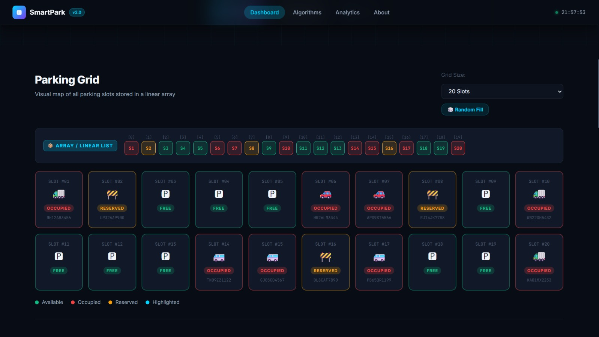

# SmartPark — Smart Parking Slot Manager

**A web-based smart parking management system demonstrating parking slot allocation, searching and sorting algorithms, and performance benchmarking.**

[Live Demo](https://prasannatz.github.io/SmartPark/)

---

## Overview

SmartPark is an interactive parking management application developed as a Smart City–focused project. It demonstrates how parking slot information can be managed using data structures, searching algorithms, sorting algorithms, and performance evaluation.

The application provides a visual parking dashboard where users can manage parking slots, explore algorithm demonstrations, and examine parking statistics.

## Features

- **Parking Slot Management:** View parking slots and their current status.
- **Slot Allocation and Release:** Manage parking occupancy through interactive controls.
- **Parking Status Visualization:** Identify available, occupied, and reserved slots.
- **Random Fill:** Populate the parking layout with simulated parking data.
- **Search Algorithm Lab:** Explore Linear Search, Binary Search, and Jump Search.
- **Sorting Algorithm Lab:** Compare Bubble Sort, Selection Sort, Insertion Sort, Quick Sort, and Merge Sort.
- **Performance Benchmarking:** Compare algorithm execution performance.
- **Analytics Dashboard:** View parking statistics and visual summaries.
- **Algorithm Complexity Reference:** Understand the theoretical time complexity of the implemented algorithms.
- **Reset Functionality:** Reset the parking layout for another demonstration.

## Dashboard Preview



*The SmartPark dashboard provides a visual interface for parking management.*

## Technology Stack

| Technology | Purpose |
|---|---|
| HTML5 | Web page structure |
| CSS3 | Styling and layout |
| JavaScript | Parking management, algorithms, and application logic |

## Algorithms Demonstrated

### Searching Algorithms

| Algorithm | Typical Time Complexity |
|---|---|
| Linear Search | O(n) |
| Binary Search | O(log n) |
| Jump Search | O(√n) |

Binary Search and Jump Search require appropriately sorted data for the search implementation.

### Sorting Algorithms

| Algorithm | Average Time Complexity |
|---|---|
| Bubble Sort | O(n²) |
| Selection Sort | O(n²) |
| Insertion Sort | O(n²) |
| Quick Sort | O(n log n) |
| Merge Sort | O(n log n) |

*These are typical theoretical complexities. Actual execution performance depends on the implementation and input data.*

## Getting Started

### Prerequisites

- A modern web browser
- Git, if you want to clone the repository

### Run Locally

1. Clone the repository:

   ```bash
   git clone https://github.com/prasannatz/SmartPark.git
   ```

2. Open the downloaded `SmartPark` folder.
3. Open `index.html` in your browser.

You can also open the folder in Antigravity or Visual Studio Code and use a local development server.

## Project Structure

```text
SmartPark/
├── index.html
├── styles.css
├── app.js
├── project_overview.md
├── test_jump_search.js
├── smartpark-dashboard.png
└── README.md
```

- `index.html` — Main web page.
- `styles.css` — Application styling.
- `app.js` — Parking management and algorithm logic.
- `project_overview.md` — Project overview documentation.
- `test_jump_search.js` — Jump Search test script.
- `smartpark-dashboard.png` — Dashboard screenshot.
- `README.md` — Project documentation.

## Testing

The project includes a Jump Search test script. Additional testing can be performed through the browser interface by checking parking allocation, release, random fill, search, sorting, benchmarking, and reset functionality.

## Project Objective

The objective of SmartPark is to demonstrate how linear data structures, searching algorithms, sorting algorithms, and performance evaluation can be applied to a practical parking management scenario.

## Future Enhancements

- Real-time occupancy updates using parking sensors.
- Database integration for persistent parking records.
- User authentication and access control.
- Parking reservation and booking functionality.
- Integration with live parking availability systems.

## License

No license has been specified yet!

---

**SmartPark — Smart Parking Slot Manager**  
*Exploring smart parking management through interactive web development and algorithms.*

